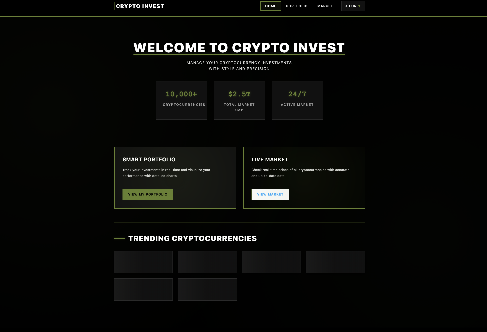

# Crypto Invest

<div align="center">

**A Professional Cryptocurrency Investment Management Platform**

[](https://angular.io/)
[](https://www.typescriptlang.org/)
[](LICENSE)

*Real-time cryptocurrency tracking, portfolio management, and market analysis*

[Features](#features) • [Installation](#installation) • [Usage](#usage) • [Technology Stack](#technology-stack) • [API Integration](#api-integration)

</div>

---

## Table of Contents

- [Overview](#overview)
- [Features](#features)
- [Technology Stack](#technology-stack)
- [Installation](#installation)
- [Usage](#usage)
- [API Integration](#api-integration)
- [Project Structure](#project-structure)
- [Multi-Currency Support](#multi-currency-support)
- [Screenshots](#screenshots)
- [Future Enhancements](#future-enhancements)
- [Contributing](#contributing)
- [License](#license)

---

## Overview

**Crypto Invest** is a modern, professional-grade web application designed for cryptocurrency investors and traders. Built with Angular 17, it provides real-time market data, comprehensive portfolio tracking, and an intuitive user interface for managing cryptocurrency investments.

### Key Highlights

- **Real-time Data**: Live cryptocurrency prices updated via CoinGecko API
- **Portfolio Management**: Track investments with automatic profit/loss calculations
- **Multi-Currency Support**: View prices in USD, EUR, GBP, JPY, and more
- **Professional Design**: Unique military-inspired UI with black, white, and olive green color scheme
- **Responsive**: Fully responsive design for desktop, tablet, and mobile devices
- **Performance**: Optimized for speed and efficiency

---

## Features

### Market Overview

- Real-time cryptocurrency prices for 10,000+ coins
- Market capitalization and 24h volume tracking
- Price change indicators with color-coded visualizations
- Advanced search and filtering capabilities
- Sortable data tables

### Portfolio Management

- Add and remove cryptocurrency investments
- Automatic profit/loss calculations
- Real-time portfolio valuation
- Individual asset performance tracking
- Purchase price and date tracking
- Percentage gain/loss indicators

### Multi-Currency Support

- Support for multiple fiat currencies (USD, EUR, GBP, JPY, CAD, AUD, CHF, CNY)
- Real-time currency conversion
- Seamless currency switching across all views
- Local storage of currency preference

### User Interface

- Modern, professional design
- Dark theme optimized for extended use
- Smooth animations and transitions
- Intuitive navigation
- Accessible and user-friendly

---

## Technology Stack

### Frontend Framework

- **Angular 17**: Latest version with standalone components
- **TypeScript 5.2**: Type-safe development
- **RxJS**: Reactive programming for data streams

### Styling

- **CSS3**: Custom design system with CSS variables
- **Responsive Design**: Mobile-first approach
- **Animations**: CSS transitions and keyframe animations

### API Integration

- **CoinGecko API**: Real-time cryptocurrency data
  - Market data
  - Price history
  - Market capitalization
  - Trading volumes

### Development Tools

- **Angular CLI**: Project scaffolding and build tools
- **Git**: Version control
- **npm**: Package management

---

## Installation

### Prerequisites

Ensure you have the following installed:

- **Node.js** (v18.0.0 or higher)
- **npm** (v9.0.0 or higher) or **yarn**
- **Git** (for cloning the repository)

### Step 1: Clone the Repository

```bash
git clone https://github.com/oiseaubleuc/cryptoInvest.git
cd cryptoInvest
```

### Step 2: Install Dependencies

```bash
npm install
```

### Step 3: Start Development Server

```bash
npm start
```

The application will be available at `http://localhost:4200`

### Step 4: Build for Production

```bash
npm run build
```

The production build will be generated in the `dist/crypto-invest` directory.

---

## Usage

### Starting the Application

1. **Development Mode**
   ```bash
   npm start
   ```
   - Runs on `http://localhost:4200`
   - Hot reload enabled
   - Source maps for debugging

2. **Production Build**
   ```bash
   npm run build
   npm run serve
   ```
   - Optimized build
   - Minified code
   - Production-ready assets

### Using the Application

#### Market View

- Browse all available cryptocurrencies
- Use the search bar to find specific coins
- Click on any cryptocurrency to view details
- Sort by market cap, price, or 24h change

#### Portfolio Management

1. Navigate to the Portfolio page
2. Click "Add Investment"
3. Select a cryptocurrency
4. Enter quantity and purchase price
5. Track your investments in real-time

#### Currency Selection

- Click the currency selector in the navigation
- Choose from available currencies (USD, EUR, GBP, etc.)
- All prices update automatically
- Preference is saved locally

---

## API Integration

### CoinGecko API

The application uses the [CoinGecko API](https://www.coingecko.com/en/api) for real-time cryptocurrency data.

**Endpoints Used:**

- `/coins/markets` - Market data for cryptocurrencies
- `/coins/{id}` - Detailed information for specific coins
- `/coins/{id}/market_chart` - Historical price data

**Rate Limits:**

- Free tier: 10-50 calls/minute
- No API key required for basic usage

### Data Updates

- Market data refreshes automatically
- Real-time price updates
- 24-hour change calculations
- Market capitalization tracking

---

## Project Structure

```
crypto-invest/
├── src/
│   ├── app/
│   │   ├── components/
│   │   │   ├── home/              # Home page component
│   │   │   ├── market/            # Market view component
│   │   │   └── portfolio/         # Portfolio management
│   │   ├── services/
│   │   │   ├── crypto.service.ts  # CoinGecko API integration
│   │   │   └── currency.service.ts # Currency management
│   │   ├── models/
│   │   │   └── crypto.model.ts    # TypeScript interfaces
│   │   ├── app.component.ts       # Root component
│   │   ├── app.config.ts          # App configuration
│   │   └── app.routes.ts          # Routing configuration
│   ├── assets/                    # Static assets
│   ├── index.html                 # Entry HTML
│   ├── main.ts                    # Bootstrap file
│   └── styles.css                 # Global styles
├── angular.json                   # Angular configuration
├── package.json                    # Dependencies
├── tsconfig.json                   # TypeScript config
└── README.md                       # This file
```

---

## Multi-Currency Support

The application supports multiple fiat currencies for displaying cryptocurrency prices:

### Supported Currencies

- **USD** (United States Dollar) - Default
- **EUR** (Euro)
- **GBP** (British Pound)
- **JPY** (Japanese Yen)
- **CAD** (Canadian Dollar)
- **AUD** (Australian Dollar)
- **CHF** (Swiss Franc)
- **CNY** (Chinese Yuan)

### Implementation

Currency selection is available throughout the application:

- Market view displays prices in selected currency
- Portfolio calculations use selected currency
- Currency preference is saved in localStorage
- All prices update automatically when currency changes

---

## Screenshots

### Market Overview


The Market View displays real-time cryptocurrency prices for 100+ coins with comprehensive market data including prices, 24h changes, market cap, and trading volume. The interface features a search bar for filtering cryptocurrencies and statistics showing total market cap. All prices are displayed in the selected currency with color-coded indicators for price changes.

---

### Portfolio Management



The Portfolio View provides comprehensive investment tracking with summary cards showing total value, total investment, and profit/loss calculations. Individual investments display detailed information including quantity, purchase price, current price, and automatic profit/loss calculations. Users can add or remove investments with real-time price updates.


---

## Future Enhancements

### Planned Features

- [ ] **Charts & Analytics**: Advanced charting with Chart.js
- [ ] **Price Alerts**: Set price alerts for cryptocurrencies
- [ ] **Historical Data**: View historical price trends
- [ ] **Export Data**: Export portfolio to CSV/PDF
- [ ] **Dark/Light Theme**: Theme switcher
- [ ] **User Authentication**: Secure user accounts
- [ ] **Backend Integration**: Cloud-based data persistence
- [ ] **Mobile App**: React Native companion app
- [ ] **Social Features**: Share portfolio performance
- [ ] **Advanced Filters**: Filter by market cap, volume, etc.

### Technical Improvements

- [ ] Unit tests with Jasmine/Karma
- [ ] E2E tests with Cypress
- [ ] Performance optimization
- [ ] PWA support
- [ ] Offline mode
- [ ] Internationalization (i18n)

---

## Contributing

Contributions are welcome! Please follow these steps:

1. Fork the repository
2. Create a feature branch (`git checkout -b feature/AmazingFeature`)
3. Commit your changes (`git commit -m 'Add some AmazingFeature'`)
4. Push to the branch (`git push origin feature/AmazingFeature`)
5. Open a Pull Request

### Development Guidelines

- Follow Angular style guide
- Write meaningful commit messages
- Add comments for complex logic
- Ensure responsive design
- Test on multiple browsers

---

## License

This project is licensed under the MIT License - see the [LICENSE](LICENSE) file for details.

---

## Author

**Hamouchi Houdaifa**

- GitHub: [@oiseaubleuc](https://github.com/oiseaubleuc)
- Project Link: [https://github.com/oiseaubleuc/cryptoInvest](https://github.com/oiseaubleuc/cryptoInvest)

---

## Acknowledgments

- [CoinGecko](https://www.coingecko.com/) for providing free cryptocurrency API
- [Angular Team](https://angular.io/) for the amazing framework
- All contributors and users of this project

---

<div align="center">

**Made with Angular**

Star this repo if you find it helpful!

</div>
