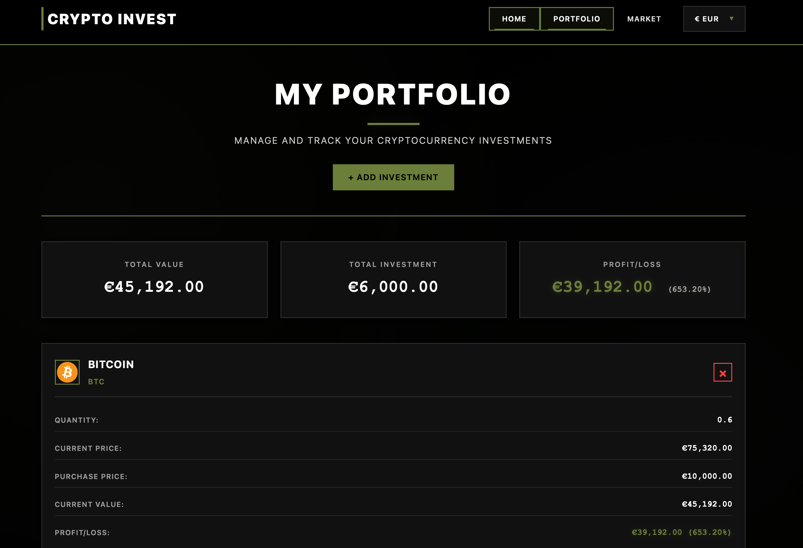

<h1 align="center">Crypto Invest</h1>
<p align="center">
  <b>Cryptocurrency portfolio and market tracker</b><br/>
  Real-time prices for 10,000+ coins, portfolio tracking with automatic profit / loss and multi-currency support.
</p>

<p align="center">
  
  
  
</p>

---

## Overview

**Crypto Invest** is a modern web application for cryptocurrency investors. Built with Angular 17, it provides real-time market data, portfolio tracking, and multi-currency support.

**Key Features:**
- Real-time cryptocurrency prices for 10,000+ coins
- Portfolio management with automatic profit/loss calculations
- Multi-currency support (USD, EUR, GBP, JPY, CAD, AUD, CHF, CNY)
- Professional dark theme UI
- Responsive design

---

## Installation

```bash
git clone https://github.com/oiseaubleuc/cryptoInvest.git
cd cryptoInvest
npm install
npm start
```

The application will be available at `http://localhost:4200`

---

## Technology Stack

- **Angular 17** - Frontend framework
- **TypeScript 5.2** - Type-safe development
- **CoinGecko API** - Real-time cryptocurrency data
- **RxJS** - Reactive programming

---


### Market Overview



The Market View displays real-time cryptocurrency prices for 100+ coins with comprehensive market data including prices, 24h changes, market cap, and trading volume. The interface features a search bar for filtering cryptocurrencies and statistics showing total market cap. All prices are displayed in the selected currency with color-coded indicators for price changes.

---

### Portfolio Management


The Portfolio View provides comprehensive investment tracking with summary cards showing total value, total investment, and profit/loss calculations. Individual investments display detailed information including quantity, purchase price, current price, and automatic profit/loss calculations. Users can add or remove investments with real-time price updates.

---

## License

This project is licensed under the MIT License.

---

## Author

** HohoServices **

- GitHub: [@oiseaubleuc](https://github.com/oiseaubleuc)
- Project Link: [https://github.com/oiseaubleuc/cryptoInvest](https://github.com/oiseaubleuc/cryptoInvest)

---

<p align="center">Built by <a href="https://github.com/oiseaubleuc">Hoho</a> · Belgium</p>
